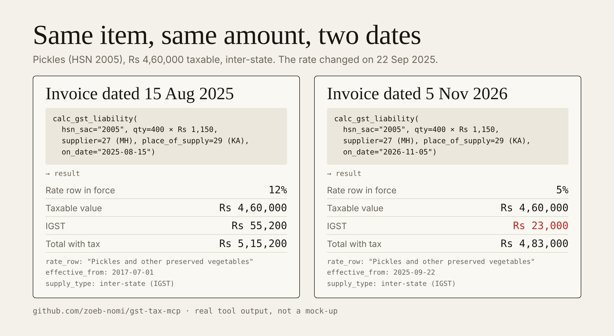
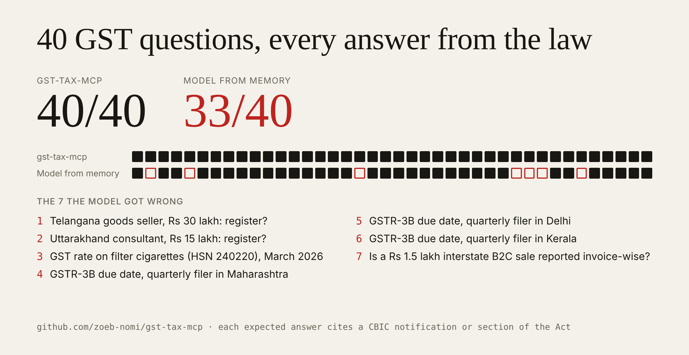

<!-- mcp-name: io.github.zoeb-nomi/gst-tax-mcp -->
# gst-tax-mcp

## Try it

```bash
pip install git+https://github.com/zoeb-nomi/gst-tax-mcp
```

Then add it to your MCP client. Claude Code, one command:

```bash
claude mcp add gst-tax -- gst-tax-mcp
```

Claude Desktop: add `"gst-tax": {"command": "<output of which gst-tax-mcp>"}` under
`mcpServers` in `claude_desktop_config.json` and restart.

Ask it:

> I am a consultant in Pune providing only services, turnover ₹30 lakh last year, all clients
> in Maharashtra. Can I use the composition scheme, and at what rate?

If an answer is wrong, open an issue with the question and what a CA would have said.
That is the most useful thing you can send.

A Model Context Protocol server that gives an AI agent, or any app that
speaks MCP, nine deterministic Indian GST tools: from "does this business need
to register?" to "what is due, for which return, by when?" to the income-tax
crossover checks that catch mismatches before a notice does.

Every rate, threshold and due date is tied to the CBIC notification or section it comes from. Not tax advice: verify with the notification or a CA before filing.

Product thinking behind it (users, metrics, trade-offs, roadmap): [`docs/PRD.md`](docs/PRD.md).

The agent layer built on top of it is measured in a companion repo:
[agent-eval-bench](https://github.com/zoeb-nomi/agent-eval-bench).

## Install

Run it without installing (needs [uv](https://docs.astral.sh/uv/)):

```bash
uvx --from git+https://github.com/zoeb-nomi/gst-tax-mcp gst-tax-mcp
```

Or install with pip (Python 3.10+):

```bash
pip install git+https://github.com/zoeb-nomi/gst-tax-mcp
gst-tax-mcp            # serves over stdio
```

The LangGraph demo agent needs extra dependencies:
`pip install "gst-tax-mcp[agent] @ git+https://github.com/zoeb-nomi/gst-tax-mcp"`.

### Claude Desktop

Add to `claude_desktop_config.json`:

```json
{
  "mcpServers": {
    "gst-tax": {
      "command": "uvx",
      "args": ["--from", "git+https://github.com/zoeb-nomi/gst-tax-mcp", "gst-tax-mcp"]
    }
  }
}
```

### Cursor

Add to `~/.cursor/mcp.json` (or `.cursor/mcp.json` in a project):

```json
{
  "mcpServers": {
    "gst-tax": {
      "command": "uvx",
      "args": ["--from", "git+https://github.com/zoeb-nomi/gst-tax-mcp", "gst-tax-mcp"]
    }
  }
}
```

## The nine tools

| # | Tool | What it answers |
|---|------|-----------------|
| 1 | `gst_applicability` | Is registration required? Is composition available? Which filer type fits? |
| 2 | `classify_hsn_sac` | HSN/SAC code → kind, description, rate in force on a date, full rate history |
| 3 | `calc_gst_liability` | Per-line CGST/SGST or IGST, cess, reverse-charge self-assessment, invoice totals |
| 4 | `reconcile_itc_tool` | Books ITC vs GSTR-2B: matched, mismatched, missing, section 17(5) blocked, claimable |
| 5 | `gst_filing_deadlines` | Due dates for GSTR-1/GSTR-3B/IFF/payment by filer type, period and state |
| 6 | `gstr1_summary_tool` | Outward register → GSTR-1 table buckets (B2B, B2CL, B2CO, exports, notes, HSN memo) |
| 7 | `validate_einvoice_tool` | IRN format, GSTIN format + checksum, mandatory fields, HSN digits by turnover, tax math |
| 8 | `itr_turnover_reconcile_tool` | GSTR-3B turnover vs ITR gross receipts; presumptive-limit breaches |
| 9 | `itr_advance_tax_estimate_tool` | Annual tax + quarterly instalments, new vs old regime comparison |

All nine are deterministic Python over rule tables in `gst_mcp/core/data.py`.
No model is in the loop. The LLM (if any) sits on top.

## Rates follow the invoice date



## Coverage and limits

Rule tables are hand-maintained. Check rates against CBIC notifications before
filing. This is not tax advice.

- **HSN/SAC rate table:** 24 prefixes, 41 rate rows, each with the date it took effect (older rates are kept, so a past invoice gets the rate of its date). The most specific prefix wins.
  - Goods: 1006 (rice), 1905 (bakery products, biscuits), 2005 (pickles and other preserved vegetables), 2402 (cigarettes, tobacco), 2523 (cement), 3304 (beauty / make-up preparations), 3305 (shampoos, hair care), 3401 (soaps), 8471 (laptops, computers), 8544 (insulated wire and cables), 8703 (motor cars), 870321 (motor cars, petrol <=1000cc), 870322 (motor cars, petrol 1000-1500cc), 870331 (motor cars, diesel <=1500cc), 8708 (motor vehicle parts), 8711 (motorcycles), 871140 (motorcycles), 871150 (motorcycles)
  - Services (SAC): 996511 (goods transport by road), 997212 (renting of commercial / non-residential property), 997331 (life and health insurance), 9982 (legal and accounting services), 998311 (IT consulting and software services), 999799 (personal care services)
  - Anything not listed is not classified.
- **Latest effective date in the rate table:** 1 February 2026.
- **Registration and composition (`gst_applicability`):** registration thresholds by State and by goods or services; two composition routes. Goods suppliers, manufacturers and restaurants get s.10(1): Rs 1.5 crore limit (Rs 75 lakh in eight States, Notif 14/2019-CT), with other services allowed up to 10% of turnover or Rs 5 lakh. Service providers above that allowance get s.10(2A): Rs 50 lakh limit in the preceding year in every State, 6% (3% CGST + 3% SGST), Notif 2/2019-CT(Rate). Every condition comes back as a rule row with its citation: no exempt supplies, no inter-State supplies, no services through an e-commerce operator that collects TCS, not a casual or non-resident taxable person, and no ice cream, pan masala or tobacco (the Notif 2/2019 Annexure, checked when `goods_hsn` is given). For a business selling both goods and services, pass `services_turnover_prior_fy`; without it the route is reported as undetermined.
- **Blocked ITC (section 17(5)):** a small subset keyed on 4 HSN/SAC prefixes (8703, 1905, 9963, 9303).
- **Deadlines:** three filer types: `monthly`, `qrdp` (quarterly, turnover up
  to Rs 5 crore) and `composition`. Periods: a month (`YYYY-MM`), an Indian
  fiscal quarter (`YYYY-Q1` to `YYYY-Q4`, Q1 = April to June) or a financial
  year (`FY2026-27`, for GSTR-9, GSTR-9C, GSTR-4 and ITR dates). State matters
  only for QRDP GSTR-3B: it separates the two state categories (22nd and 24th).
  There are no per-state extensions; the override table holds a single
  historical example.
- **E-invoice validator checks:** IRN is present and 64 hex characters; seller
  and buyer GSTIN format and mod-36 checksum; invoice number, date and place of
  supply; at least one line; HSN/SAC present and long enough (4 digits up to
  Rs 5 crore turnover, 6 above); tax lines equal taxable value x rate; invoice
  total equals the sum of lines; a warning when same-state parties carry IGST.
  **It does not** recompute the IRN hash, verify a signature or QR code, call
  the IRP portal, or check that a GSTIN is actually registered or active.
- Fixtures and demo clients are synthetic, including every GSTIN in them. Figures the tools cannot source
  (ITR gross receipts, projected income) are passed in by the caller, never
  guessed.

## Eval

47 questions a business owner would ask (registration, services composition, rates on a date, liability split, blocked credit, return dates, e-invoice, income-tax crossover), each with the expected answer taken from a CBIC notification or a section of the Act, never from the tools. Cases, sources and the runner are in [`eval/`](eval/README.md).

| Run | Score |
|---|---|
| gst-tax-mcp tools | 47/47, every answer cited |
| Claude Haiku answering from memory, no tools, blind | 33/40 (run on the first 40 cases; the 7 services-composition cases are not in it yet) |



The model alone missed the quarterly GSTR-3B due-date groups (all three cases), two state registration thresholds, the B2C-large limit and the February 2026 change for cigarettes. Building the set also found and fixed 18 rules in the tools' own tables before release; the full history is in [`eval/README.md`](eval/README.md). Because the tables were checked against these same 40 cases, a fresh held-out set is the next step. The 7 services-composition cases (`SCOMP-*`, added 13 Nov 2026) come from the text of Notif 2/2019-CT(Rate) and s.10(2A); the tools before this change failed 5 of them (they gave a service provider the goods limit of Rs 1.5 crore).

Known gaps outside these cases: bakery items (1905) are treated as blocked credit in every case; the label on 9303 is wrong; small-car length and engine-size conditions are flagged, not enforced; advance tax for 44AD/44ADA filers is shown as four instalments instead of one by 15 March.

## The agent

The server itself makes no network calls. The optional agent (`pip install "gst-tax-mcp[agent]"`) sends your questions and the tool results to OpenRouter, using your own `OPENROUTER_API_KEY`.

`gst_mcp/agent.py` is a LangGraph ReAct agent whose tools are these nine,
loaded from the MCP server over stdio via `langchain-mcp-adapters`. One
session walks a client quarter (applicability, deadlines, reverse-charge
liability, ITC reconciliation, GSTR-1, e-invoice, ITR crossover) and prints a
filing pack. Run it from a source checkout:

```bash
python -m venv .venv && .venv/bin/pip install -e ".[agent]"
OPENROUTER_API_KEY=... .venv/bin/python -m gst_mcp.agent \
    --fixtures fixtures/priya_pickles --period 2026-Q2
```

A recorded live run: `demo/transcripts/agent_live_session.txt`.

## Develop

```bash
python -m venv .venv && .venv/bin/pip install -e ".[dev]"
.venv/bin/python scripts/mcp_smoke.py    # spawn server over stdio, list 9 tools, call two
.venv/bin/python -m pytest tests -q      # 43 unit tests on the core engine
.venv/bin/gst-tax-mcp                    # serve stdio
```

`pip install -r requirements.txt` also works for a plain checkout.

## Architecture

`docs/architecture.md` has a component diagram (Mermaid) and the paths
through it: the agent session and direct MCP use. Any MCP client or app can
call the server.

## License

MIT, see `LICENSE`.
