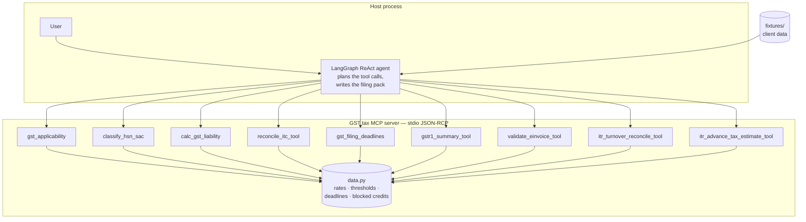

# Architecture — GST tax MCP module

How the nine-tool GST MCP server relates to the LangGraph filing agent and to
any other MCP client.

## Paths through the diagram

1. **Agent session (public demo).** A person opens a filing session; the
   LangGraph agent loads the nine tools over MCP stdio, calls them in a
   sensible order (applicability → deadlines → liability → ITC → GSTR-1 →
   e-invoice → ITR crossover) and prints the filing pack. Run
   `demo/filing_session.py` / `demo/transcripts/filing_session.txt`.
2. **Direct MCP use.** Any MCP client can spawn `python -m gst_mcp.server`
   and call the nine tools (see `scripts/mcp_smoke.py`).

## Design rules

- **Code crunches, models think.** Rates, thresholds, deadlines, GSTIN
  checksums and section 17(5) blocked credits are tables in
  `gst_mcp/core/data.py`; the tools produce the same output for the same
  input. No model is in the loop.
- **One protocol, many clients.** The agent and any other MCP client both
  reach the same nine tools over MCP stdio; neither imports the engine.
- **Swappable module.** Any host that can spawn a subprocess and speak JSON
  over stdio can run the server — Python, Node, or another agent
  runtime.
- **The LLM sits on top, not inside.** The agent plans which tools to call
  and writes the plain-language summary; every number it quotes comes from a
  tool response.

## Honest limits

- The rate/threshold/deadline tables are a curated sample — verify against
  CBIC notifications before production use.
- Client data in the fixtures and demos is synthetic.
- Figures the tools cannot source from a filing (ITR gross receipts,
  projected income) are passed in, never guessed.
- Not a tax opinion.
